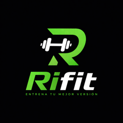
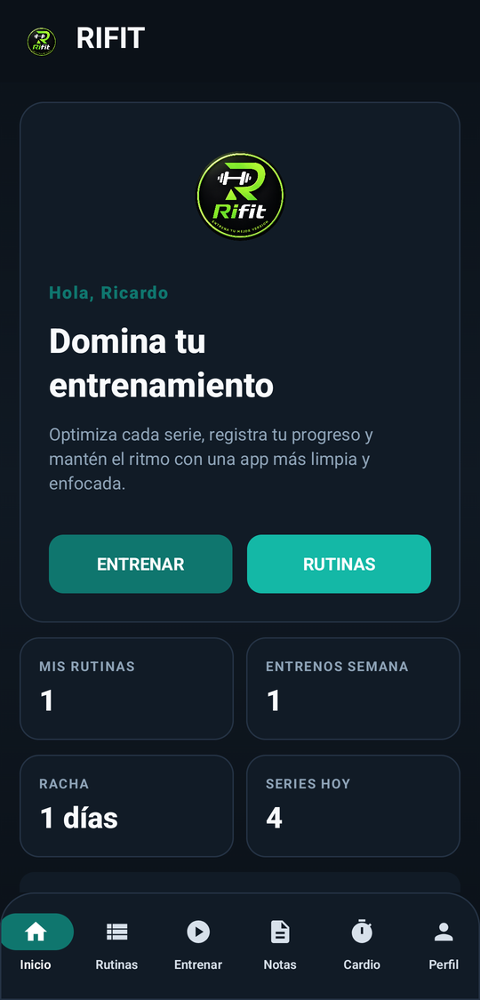
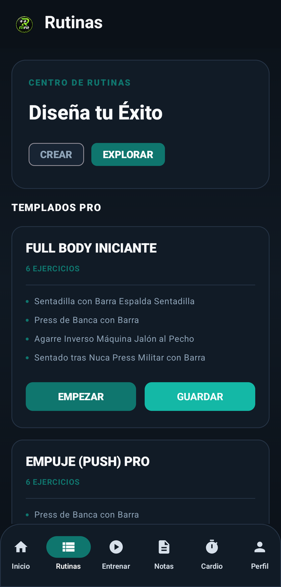
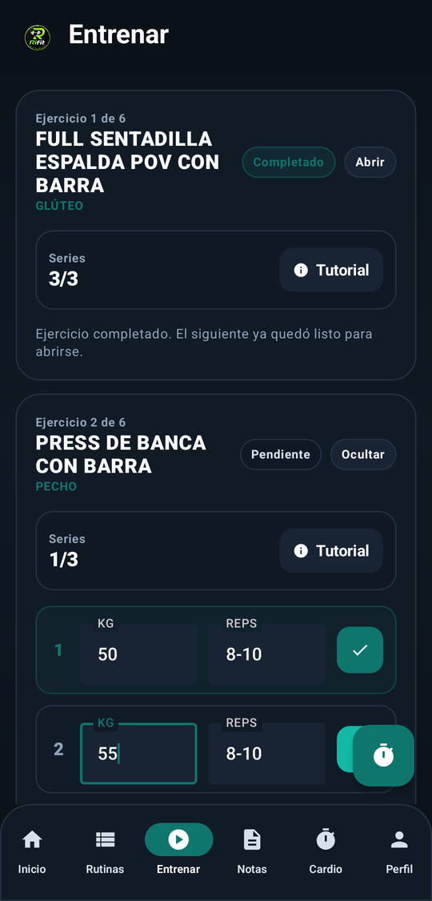
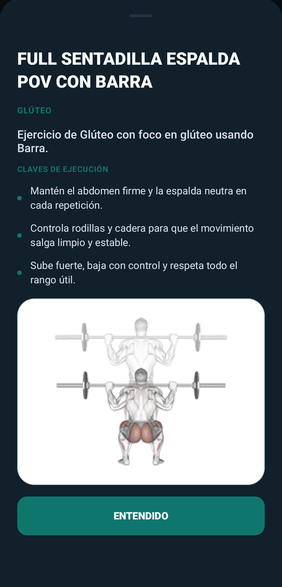
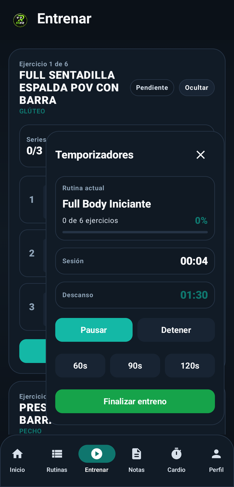
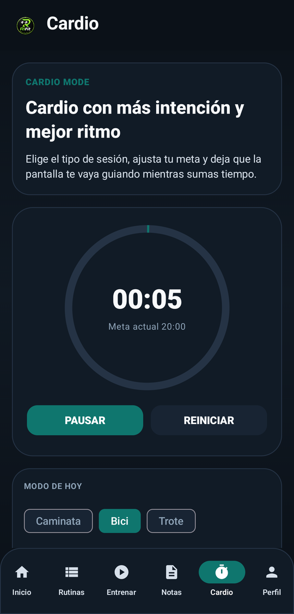
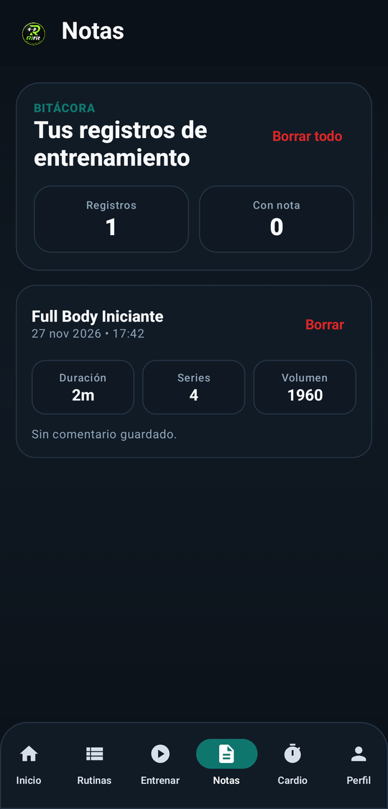
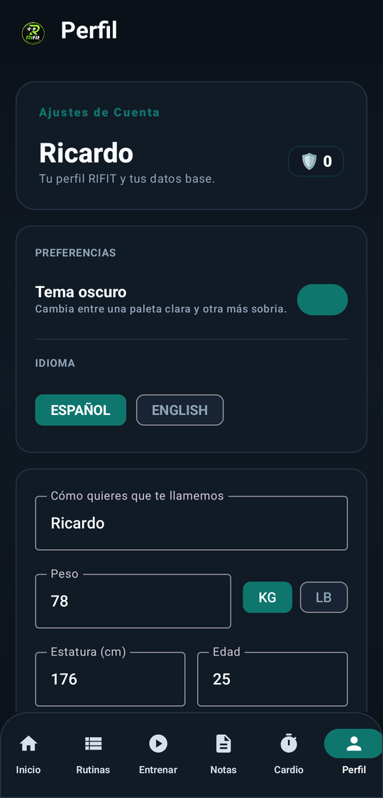
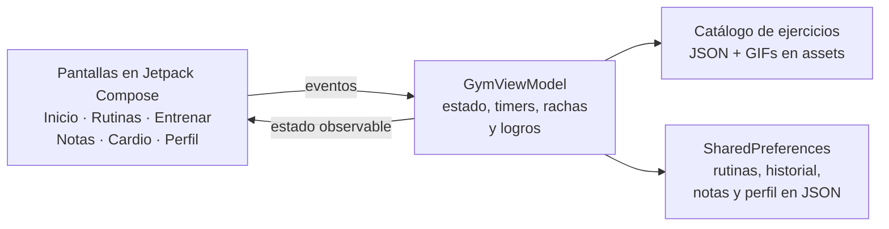

<p align="center">
  
</p>

<h1 align="center">RIFIT</h1>

<p align="center">
  App nativa de Android para entrenar en el gimnasio: rutinas, registro de series, temporizadores, cardio y rachas.<br>
  Kotlin · Jetpack Compose · Material 3 · MVVM
</p>

> **🇺🇸 In English:** RIFIT is a native Android workout app built with Kotlin and Jetpack Compose. Users build routines from a catalog of 1,200+ animated exercises (or start from ready-made templates), log weight and reps set by set with session and rest timers, run guided cardio sessions and keep a daily streak protected by earned "shields". It's fully bilingual (Spanish/English), works offline and stores everything on the device.

---

<p align="center">
  
  
  
  
</p>
<p align="center">
  
  
  
  
</p>

## Qué hace

| Sección | Qué encuentras |
|---|---|
| **Inicio** | Resumen del día: rutinas guardadas, entrenamientos de la semana, racha y series de hoy, con la actividad semanal |
| **Rutinas** | Crea rutinas propias desde el catálogo (con filtros por músculo y equipo) o guarda una de las plantillas: Full Body, Push, Pull, Pierna y más |
| **Entrenar** | Modo entrenamiento ejercicio por ejercicio: peso y repeticiones de cada serie, series extra, progreso de la rutina y tutorial con animación y claves de ejecución |
| **Temporizadores** | Cronómetro de la sesión y descanso de 60, 90 o 120 segundos, siempre a un toque |
| **Notas** | Bitácora de cada entrenamiento con duración, series, volumen total y comentarios |
| **Cardio** | Sesiones de caminata, bici o trote con meta de tiempo, anillo de progreso y consejos según el avance |
| **Perfil** | Datos personales, kg o lb, tema, idioma y logros por desbloquear |

### Detalles que me gustan

- **Catálogo de más de 1,200 ejercicios con animación**, guardados dentro de la app para que funcionen sin internet. Los nombres se traducen y se limpian automáticamente para que se lean bien en español.
- **Rachas con escudos:** cada dos días seguidos de entrenamiento ganas un escudo 🛡️ que protege tu racha si un día no puedes ir.
- **Logros** que se desbloquean con el uso: primer entrenamiento, primera rutina propia, tres entrenamientos en una semana, 20, 100 y 250 series acumuladas, y más.
- **Bilingüe:** toda la interfaz cambia entre español e inglés desde el perfil.
- **Primer uso guiado:** un onboarding pide nombre, peso, estatura y edad, y después entras directo a la app.

## Cómo está hecha



- **Arquitectura MVVM:** las pantallas son funciones de Compose que solo dibujan el estado, y la lógica (temporizadores, cálculo de rachas, volumen y logros) vive en el `ViewModel`.
- **UI declarativa** con Material 3, tema oscuro propio y navegación inferior con seis secciones.
- **Persistencia local:** rutinas, historial, notas y perfil se guardan en el dispositivo como JSON, sin cuentas ni servidores.
- **Animaciones de los ejercicios** con Coil (soporte de GIF), cargadas desde los assets de la app.

## Stack

| | |
|---|---|
| Lenguaje | Kotlin |
| UI | Jetpack Compose, Material 3, Material Icons Extended |
| Arquitectura | MVVM con `ViewModel` y estado de Compose |
| Imágenes | Coil + Coil GIF |
| Otros | AndroidX Core Splash Screen, Lifecycle, Activity Compose |
| Mínimo | Android 7.0 (API 24) |

## Cómo correrla

1. Abre la carpeta `ProductividadApp/` en Android Studio.
2. Espera a que Gradle sincronice.
3. Corre la app en un emulador o en tu celular con **Run ▶**.

O desde la terminal:

```bash
cd ProductividadApp
./gradlew assembleDebug
# El APK queda en app/build/outputs/apk/debug/app-debug.apk
```
